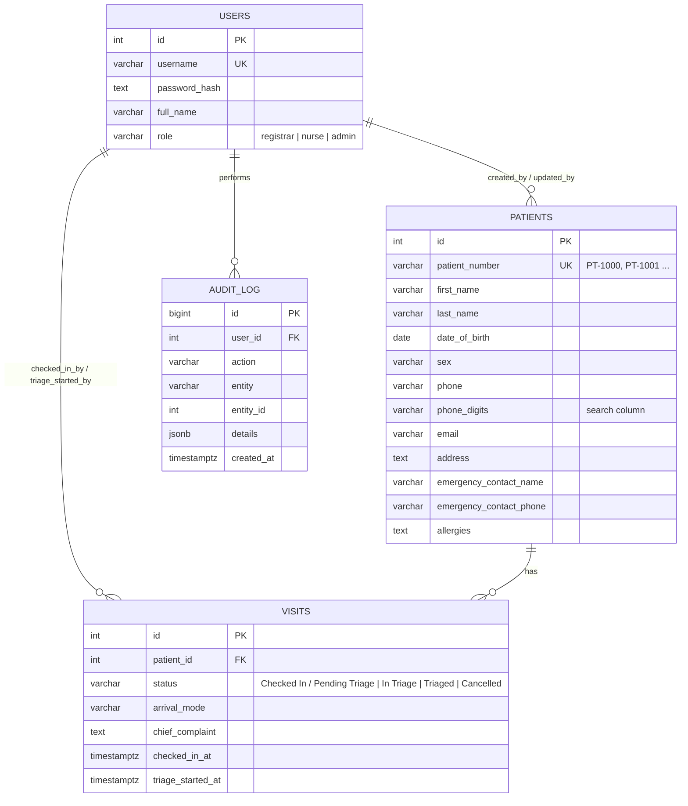

# Electronic Health Record & Information Retrieval System

Patient check-in module for a hospital: **React** front end, **Express** back end, **PostgreSQL** database.

## User story

> I want to search and retrieve existing patient records or create/update patient profiles upon arrival and transfer/send the active profile to the triage queue,
> so that returning and new patients are checked in quickly and care providers receive their digital charts immediately.

**Verification step:** search for a patient by ID, name or phone number, retrieve the profile, update contact info if necessary, send the record to the Triage queue, and confirm the chart appears as **"Checked In / Pending Triage"**.

---

## 1. Quick start

**Prerequisites:** Node.js 18+, PostgreSQL 14+ (needs the `pg_trgm` extension, included in the standard contrib package).

```bash
# 1. Create the database and user (once)
psql -U postgres -c "CREATE USER ehr_user WITH PASSWORD 'ehr_pass' SUPERUSER;"   # SUPERUSER only so CREATE EXTENSION works locally
psql -U postgres -c "CREATE DATABASE ehr_db OWNER ehr_user;"

# 2. Backend
cd backend
cp .env.example .env            # edit DATABASE_URL / JWT_SECRET if needed
npm install
npm run db:setup                # creates tables + demo users + demo patients (DROPS existing tables)
npm start                       # API on http://localhost:4000

# 3. Frontend (new terminal)
cd frontend
npm install
npm run dev                     # UI on http://localhost:5173
```

> On a managed database where you cannot use `SUPERUSER`, run `CREATE EXTENSION pg_trgm;` once as an admin instead.

### Demo accounts

| Username    | Password         | Role      | Can do                                   |
|-------------|------------------|-----------|------------------------------------------|
| `registrar` | `Registrar#2026` | registrar | search, register, edit, check in, cancel |
| `nurse`     | `Nurse#2026`     | nurse     | search, view queue, start triage         |
| `admin`     | `Admin#2026`     | admin     | everything + audit log                   |

Change these before any real deployment.

### Demo patients (seeded)
Amara Okafor (`PT-1000`), John Smith (`PT-1001`), Fatima Hassan, Michael Johnson, Sarah Smith.

---

## 2. Verifying the user story

### Automated (recommended for your evidence)

With the API running and the database freshly seeded:

```bash
cd backend
npm run verify     # walks through the verification step end to end, prints PASS/FAIL per check
npm test           # API integration tests (node:test)
```

`npm run verify` creates its own unique patient, then: searches by **ID**, **name** and **phone**; retrieves the profile; updates phone/email/address; checks the patient in; logs in as the **nurse** and confirms the queue entry has status **"Checked In / Pending Triage"** and shows the *updated* phone number. It also checks the guard-rails (duplicate check-in → 409, nurse cannot check in → 403, no token → 401).

### Manual walkthrough (UI)

1. Sign in as `registrar`.
2. In **Patient Search** type `PT-1001`, `Smith, John` or `07700 900456` → *John Smith* appears.
3. Click the result → the profile opens. Change the phone number.
4. Enter a reason for visit and click **Save changes & send to triage**.
5. A green banner confirms the status **Checked In / Pending Triage**. Open **Triage Queue** (or sign in as `nurse`): the chart is listed with that status and the updated phone number.
6. As `nurse`, click **Start triage** → status changes to *In Triage*.
7. New patient: search for a name that doesn't exist → **Register new patient**. Registering a duplicate name + date of birth triggers a duplicate warning.

---

## 3. Architecture

```
┌────────────────────┐   HTTPS/JSON   ┌───────────────────────────┐   SQL   ┌──────────────┐
│ React (Vite)       │ ─────────────▶ │ Express REST API          │ ──────▶ │ PostgreSQL   │
│  Login             │   JWT Bearer   │  helmet · cors · zod      │   pg    │  users       │
│  Patient search    │ ◀───────────── │  auth + RBAC middleware   │ ◀────── │  patients    │
│  Profile / edit    │                │  routes: auth, patients,  │         │  visits      │
│  Check-in          │                │          triage, audit    │         │  audit_log   │
│  Triage queue      │                └───────────────────────────┘         └──────────────┘
└────────────────────┘
```

Key design decisions

| Concern | Decision |
|---|---|
| **Fast retrieval** | Unique index on `patient_number`; `phone_digits` column (digits only) so any phone formatting matches, and full numbers are compared on their last 9 digits so `+44 7700 900123` and `07700 900123` find the same record; `pg_trgm` GIN index for partial-name search; search results ranked: exact ID → exact phone → name. |
| **No duplicate check-ins** | Partial unique index `uq_one_active_visit_per_patient` enforces one active visit per patient at the database level (race-safe), plus a friendly check in the API. |
| **Atomic check-in** | Contact edits + visit creation + audit entries happen in **one transaction** — the nurse never sees a visit with stale contact details. |
| **Duplicate patient records** | Registering the same name + DOB returns `409` with the matching records; user can open the existing one or explicitly override. |
| **Security** | bcrypt password hashes, JWT auth, role-based access control, Zod input validation, parameterised SQL only, helmet headers, restricted CORS. |
| **Accountability** | Every search, view, create, update, check-in and triage action is written to `audit_log` (who, what, when, field-level before/after on updates) — admin-readable via `/api/audit`. |
| **Dates of birth** | Returned as plain `YYYY-MM-DD` strings to avoid time-zone shifts. |

### Entity-relationship diagram



### Visit status lifecycle

```
 check-in            nurse starts triage        (later modules)
────────▶ [Checked In / Pending Triage] ─────▶ [In Triage] ─────▶ [Triaged]
                     │ cancel (registrar/admin)
                     ▼
                [Cancelled]
```

---

## 4. REST API

All endpoints except `login` and `health` require `Authorization: Bearer <token>`.

| Method | Path | Roles | Purpose |
|---|---|---|---|
| POST | `/api/auth/login` | public | `{username, password}` → `{token, user}` |
| GET | `/api/auth/me` | any | current user |
| GET | `/api/patients/search?q=` | any | search by **ID**, **name** (`John`, `Smith, John`) or **phone** (any format); min 2 chars; max 25 results, each with `activeVisit` |
| GET | `/api/patients/:id` | any | full profile + active visit + visit history |
| POST | `/api/patients[?force=true]` | registrar, admin | register patient; `409` + `duplicates` if same name & DOB exists |
| PUT | `/api/patients/:id` | registrar, admin | partial update; returns `changedFields` |
| POST | `/api/patients/:id/check-in` | registrar, admin | `{arrivalMode, chiefComplaint, contact?}` → creates visit with status **Checked In / Pending Triage**; `409` if already queued |
| GET | `/api/triage/queue[?status=]` | any | active queue, oldest first, with wait minutes and counts |
| POST | `/api/triage/:visitId/start` | nurse, admin | Pending → In Triage |
| POST | `/api/triage/:visitId/cancel` | registrar, admin | cancel a mistaken check-in (pending only) |
| GET | `/api/audit?entity=&entityId=&limit=` | admin | audit trail |

Example — check in and update the phone number atomically:

```http
POST /api/patients/2/check-in
Authorization: Bearer <token>
Content-Type: application/json

{ "arrivalMode": "Walk-in", "chiefComplaint": "Chest pain", "contact": { "phone": "+44 7999 123456" } }
```
```json
{
  "message": "Patient checked in and sent to the triage queue",
  "visit": { "id": 7, "patientId": 2, "status": "Checked In / Pending Triage", "arrivalMode": "Walk-in" },
  "updatedFields": ["phone"]
}
```

---

## 5. Project structure

```
ehr-system/
├── backend/
│   ├── db/schema.sql              # tables, indexes, constraints
│   ├── db/sql-smoke-test.sql      # psql script exercising the core queries
│   ├── scripts/setup-db.js        # applies schema + seeds demo data
│   ├── scripts/verify-user-story.js
│   ├── src/{app,server,db,audit,errors}.js
│   ├── src/middleware/{auth,validate}.js
│   ├── src/routes/{auth,patients,triage,audit}.js
│   └── tests/api.test.js
└── frontend/
    ├── vite.config.js             # dev proxy /api -> :4000
    └── src/{App,AuthContext,api,utils}.js(x), styles.css
        ├── pages/{LoginPage,PatientsPage,TriagePage}.jsx
        └── components/{PatientForm,PatientProfile}.jsx
```

---

## 6. Limitations and suggested extensions (for your dissertation's discussion chapter)

- **Scope:** this module covers registration/check-in and the hand-off to triage. Clinical charting (vitals, diagnoses, medications, orders) would be later modules reading the same `patients`/`visits` tables.
- **Real-time updates:** the triage queue polls every 15 s. WebSockets or Server-Sent Events would deliver check-ins instantly.
- **Security hardening for production:** HTTPS termination, login rate-limiting / account lockout, refresh tokens or short-lived sessions, secrets manager for `JWT_SECRET`, encryption at rest, database role without superuser, and compliance review (HIPAA / GDPR / UK Data Protection Act 2018, NHS DSPT as applicable).
- **Patient identity:** duplicate detection uses exact name + DOB; production systems use probabilistic matching and national identifiers (e.g. NHS number).
- **Interoperability:** exposing HL7 FHIR `Patient` / `Encounter` resources would allow integration with other hospital systems.
- **Testing:** add React component tests (Vitest + Testing Library) and CI that runs the API tests against a throwaway PostgreSQL container.
